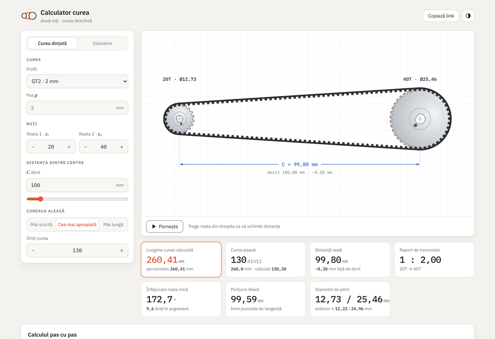

# Belt Calculator

Work out the belt length for a two-pulley drive from the center distance and the pitch diameters, and see the drive drawn to scale.

**[Live demo →](https://mihaimpmo.github.io/belt-calculator/)**

<picture>
  <source media="(prefers-color-scheme: dark)" srcset="assets/screenshot-dark.png">
  
</picture>

## Features

- Belt length from the exact formula, with the common approximation shown for comparison
- Scale drawing of the pulleys and belt, animated, updated as you type
- Drag the right pulley to change the center distance
- Warnings when the pulleys overlap or the belt barely wraps the small pulley
- The calculation shown step by step with your values
- The values are kept in the URL, so a setup can be bookmarked or shared
- Light and dark theme, works on phones
- Runs entirely in the browser: no build step, no server, no tracking

## What the results mean

| Result | Meaning |
| --- | --- |
| **Belt length** | Length of the belt measured along its pitch line. This is the number to match against belt sizes. |
| **Ratio** | $D_2 / D_1$: how many turns the small pulley makes for one turn of the large one. |
| **Wrap, small pulley** | How much of the small pulley the belt is in contact with, in degrees. Less contact means less grip: flat belts start to slip, timing belts can skip teeth under load. Aim for more than 120°; if it is lower, move the pulleys apart or add an idler. |
| **Free span** | Length of one straight run of belt between the two pulleys. Belt tension is often specified as a deflection at the middle of this span, and it also tells you how much room there is between the two runs. |

## Formulas

With $C$ the center distance and $D_1$, $D_2$ the pitch diameters:

$$
\varphi = \arcsin\frac{D_2 - D_1}{2C}
$$

$$
L = 2C\cos\varphi + \frac{\pi(D_1 + D_2)}{2} + \varphi\,(D_2 - D_1)
$$

The approximation found in most handbooks, accurate when the pulleys are far apart relative to their size difference:

$$
L \approx 2C + \frac{\pi(D_1 + D_2)}{2} + \frac{(D_2 - D_1)^2}{4C}
$$

Wrap angles:

$$
\theta_{\text{small}} = \pi - 2\varphi, \qquad \theta_{\text{large}} = \pi + 2\varphi
$$

For a timing pulley with $z$ teeth and pitch $p$ (2 mm for GT2, for example), the pitch diameter is

$$
D = \frac{z\,p}{\pi}
$$

and the number of teeth on the belt is $L / p$, rounded to a belt size you can buy.

## Limitations

- Open belt drives only (both pulleys turning the same way), with no idler.
- All values are in millimetres.
- Use pitch diameters, not outside diameters. For timing pulleys the pitch diameter is slightly larger than the outside diameter.

## Running locally

Download or clone the repository and open `index.html` in a browser.

The formula tests need Node 18 or newer:

```bash
npm test
```

### Project layout

```
index.html          page markup
css/style.css       styles
js/belt.js          the math, no browser dependencies
js/app.js           inputs, drawing and animation
tests/belt.test.js  tests for the math
```

## Contributing

Bug reports and pull requests are welcome. If you change the math in `js/belt.js`, add or update a test in `tests/belt.test.js`.

## License

[MIT](LICENSE)
